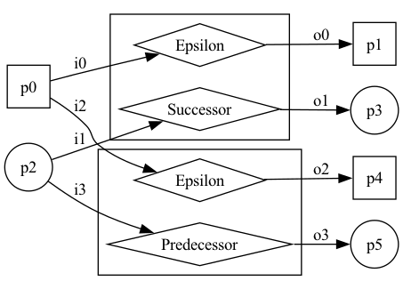
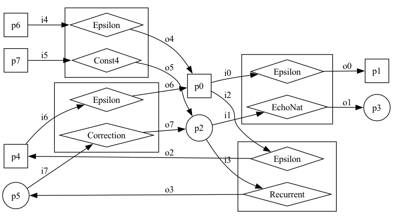
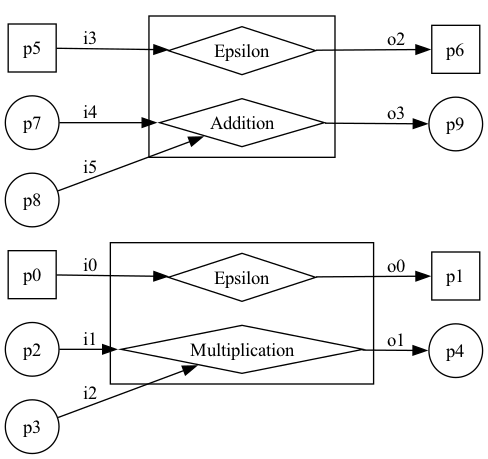
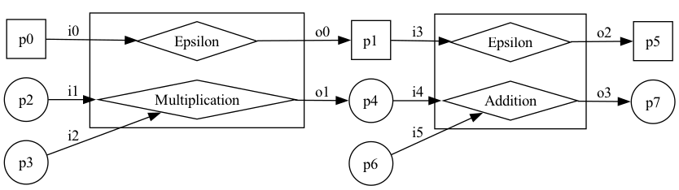
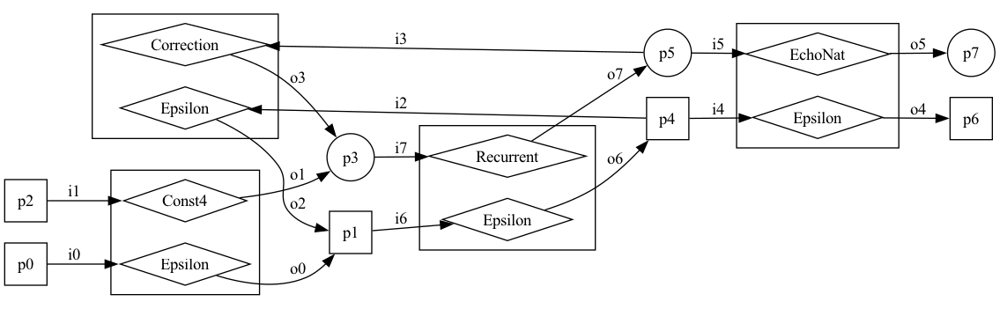
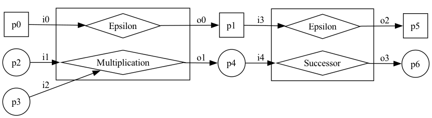
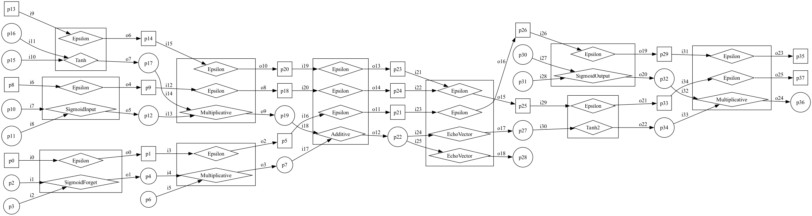

# Computon Framework Tutorial

This project presents a series of examples to demonstrate the use of the [Computon Model's Java API](https://github.com/damianarellanes/computons-java). More use cases will be added as development progresses.

The project currently demonstrates two use cases: ARITH and LSTM. 

- ARITH provides a simple example for the formation of asynchronous parallel, branching, head-iterative, tail-iterative, partial sequential and total sequential composite computons.
- LSTM demonstrates the compositional construction of a Long Short-Term Memory, including the formation of composites representing forget gates, input gates, output gates, cell states and complete memory cells.

## 🚀 Getting Started

1. In the "application.properties" file, change the value of the "spring.profiles.active" key to specify the tests you want to perform. For Arith, you can specify "test-branching", "test-head", "test-parallel", "test-partialseq", "test-tail" and "test-totalseq". For LSTM, there is only one option: "test-lstm". In general, "application.properties" admits multiple comma-separated values.
- "test-branching" creates a branching computon which chooses between a device that computes the successor of a number and a device for computing the predecessor.
  

    
  

- "test-head" creates a head-iterative computon to compute "$n+3$" $k>=0$ times. The number of times is randomly decided.
  

    
  

- "test-parallel" creates a computon for the execution of binary multiplication and binary addition in parallel.
  

    
  

- "test-partialseq" creates a partial sequential computon for computing "$(a \times b) + c$". Here, an addition device receives the result from a multiplication device and a value c from the external world.
  

    
  
  
- "test-tail" creates a tail-iterative computon to compute either "$n+5$" or "$n+3" k>0 times. The decision is random.
  

    
  
  
- "test-totalseq" creates a total sequential computon to compute "$(a \times b) + 1$".
  

    
  
  
- "test-lstm" creates a composite computon that embodies the behaviour of an LSTM.
  

    
  

2. Run the "PublishDevicesA.java" file to deploy computing devices as web services. Replace A with either "Arith" or "LSTM", depending on the use case you want to run. 
3. Run the "Main.java" file to execute the use cases you specified in the "application.properties" file. 
  - Do not remove the "SpringBootApplication" annotation since this indicates the packages where the use cases are implemented.
  - A successful run will output the execution trace in discrete time steps. We use a vector of the form [s1,s2,...,sn] to represent port states where port ids correspond to vector indices.
  - A successful run generates a PNG figure of the executed computon, saved in the root folder. The corresponding figures are shown above. Please note that an "epsilon device" is used for echoing control.

## 🛠️ Development

Development is currently taking place on the development branch.

Contributions, suggestions and feedback are welcome.

## 📄 License

This project is licensed under the BSD 3-Clause License. See the LICENSE file for details.

## 🖋️ Attribution

If you use this project in your own work, please credit the author and link back to this repository. # Computon Framework Tutorial

This project presents a series of examples to demonstrate the use of the [Computon Model's Java API](https://github.com/damianarellanes/computons-java). More use cases will be added as development progresses.

The project currently demonstrates two use cases: ARITH and LSTM. 

- ARITH provides a simple example for the formation of asynchronous parallel, branching, head-iterative, tail-iterative, partial sequential and total sequential composite computons.
- LSTM demonstrates the compositional construction of a Long Short-Term Memory, including the formation of composites representing forget gates, input gates, output gates, cell states and complete memory cells.

## 🚀 Getting Started

1. In the "application.properties" file, change the value of the "spring.profiles.active" key to specify the tests you want to perform. For Arith, you can specify "test-branching", "test-head", "test-parallel", "test-partialseq", "test-tail" and "test-totalseq". For LSTM, there is only one option: "test-lstm". In general, "application.properties" admits multiple comma-separated values.
- "test-branching" creates a branching computon which chooses between a device that computes the successor of a number and a device for computing the predecessor.
  

    
  

- "test-head" creates a head-iterative computon to compute "n+3" k>=0 times. The number of times is randomly decided.
  

    
  

- "test-parallel" creates a computon for the execution of binary multiplication and binary addition in parallel.
  

    
  

- "test-partialseq" creates a partial sequential computon for computing "(a x b) + c". Here, an addition device receives the result from a multiplication device and a value c from the external world.
  

    
  
  
- "test-tail" creates a tail-iterative computon to compute either "n+5" or "n+3" k>0 times. The decision is random.
  

    
  
  
- "test-totalseq" creates a total sequential computon to compute "(a x b) + 1".
  

    
  
  
- "test-lstm" creates a composite computon that embodies the behaviour of an LSTM.
  

    
  

2. Run the "PublishDevicesA.java" file to deploy computing devices as web services. Replace A with either "Arith" or "LSTM", depending on the use case you want to run. 
3. Run the "Main.java" file to execute the use cases you specified in the "application.properties" file. 
  - Do not remove the "SpringBootApplication" annotation since this indicates the packages where the use cases are implemented.
  - A successful run will output the execution trace in discrete time steps. We use a vector of the form [s1,s2,...,sn] to represent port states where port ids correspond to vector indices.
  - A successful run generates a PNG figure of the executed computon, saved in the root folder. The corresponding figures are shown above. Please note that an "epsilon device" is used for echoing control.

## 🛠️ Development

Development is currently taking place on the development branch.

Contributions, suggestions and feedback are welcome.

## 📄 License

This project is licensed under the BSD 3-Clause License. See the LICENSE file for details.

## 🖋️ Attribution

If you use this project in your own work, please credit the author and link back to this repository. 